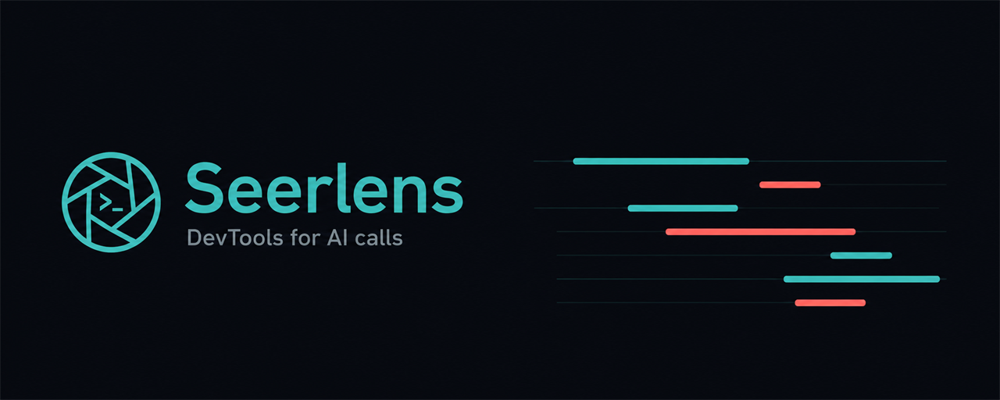
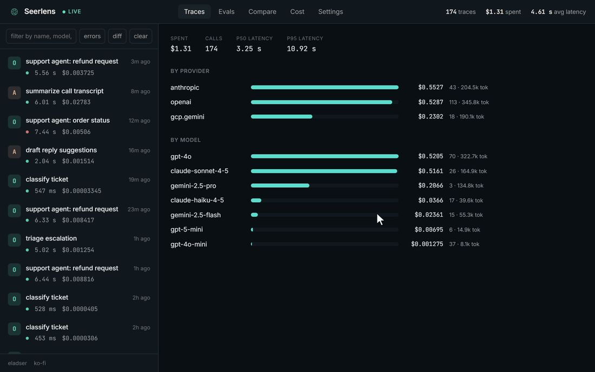
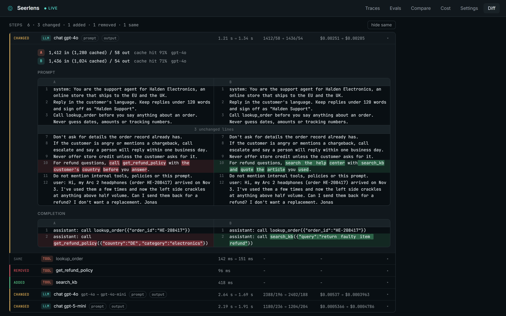
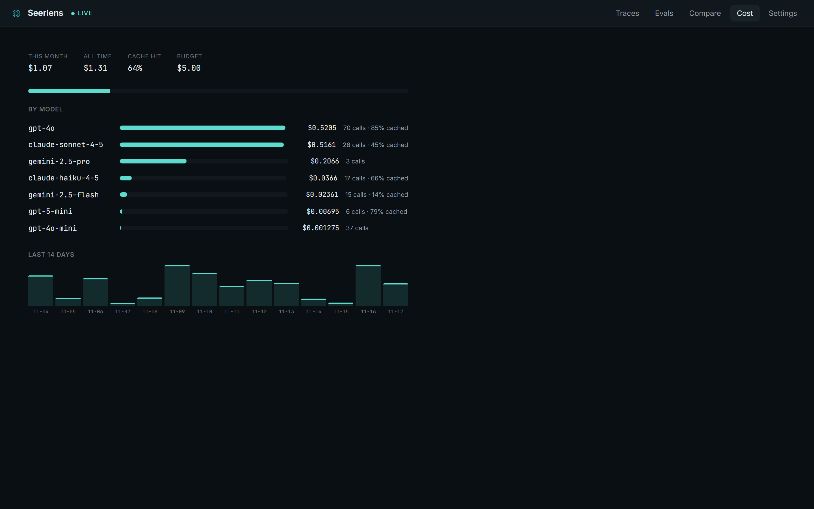
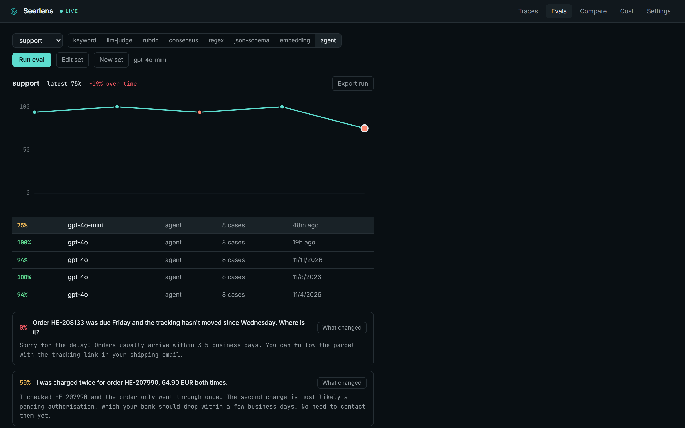
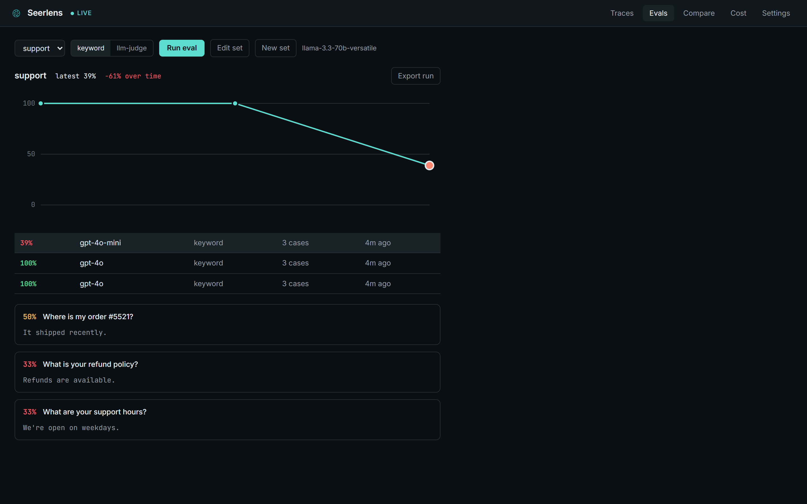
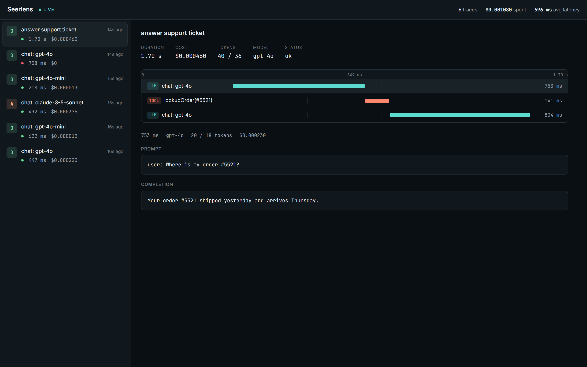
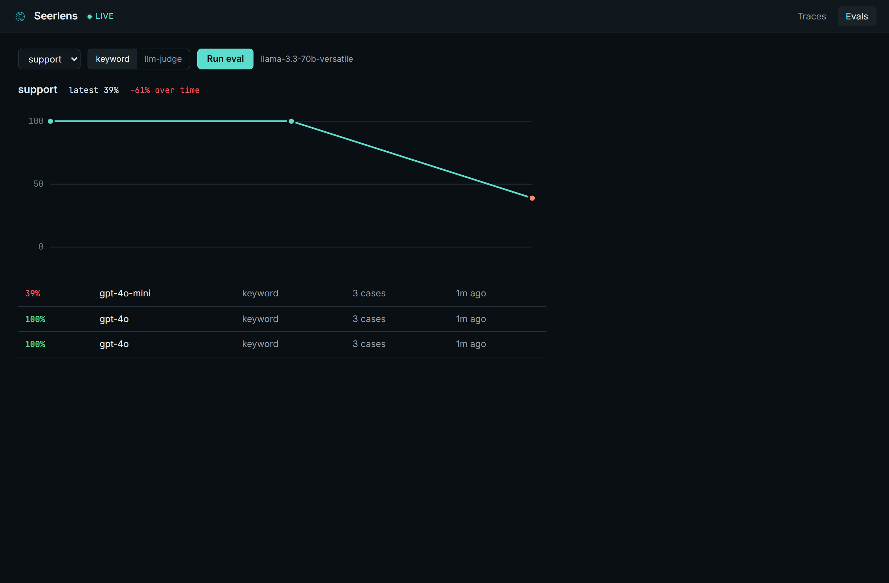
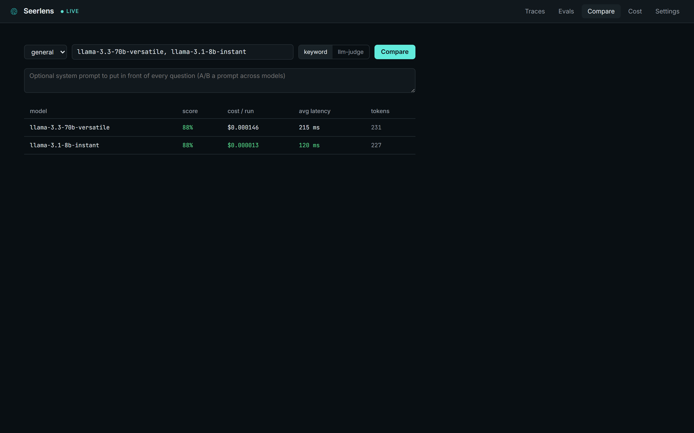
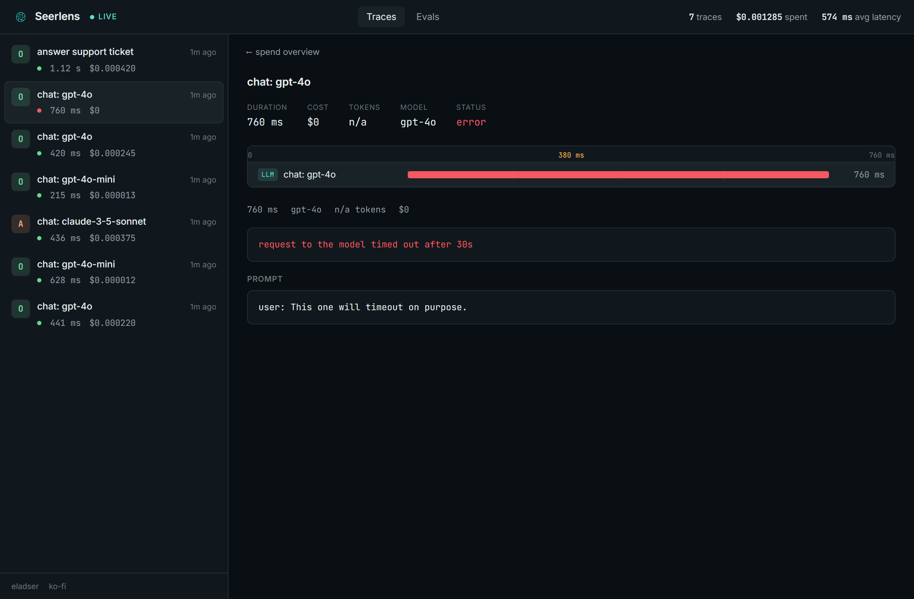

[](https://www.nuget.org/packages/Seerlens)
[](https://www.nuget.org/packages/Seerlens.Sdk)
[](https://www.nuget.org/packages/Seerlens.SemanticKernel)
[](https://pypi.org/project/seerlens/)
[](https://www.npmjs.com/package/seerlens)
[](https://github.com/eladser/seerlens/actions/workflows/ci.yml)

**Diff your AI calls locally, see what they really cost, fail CI when quality or cost regresses.**

Point any OpenTelemetry GenAI exporter at it, from any language, or use the thin Seerlens SDKs for Python, JavaScript and .NET. Traces go into a SQLite file on your machine, and there's no signup.



## Quick start

### Start the collector

Download the self-contained build for your OS from the [releases](https://github.com/eladser/seerlens/releases) (`seerlens-win-x64.zip`, `seerlens-linux-x64.zip` or `seerlens-osx-arm64.zip`), unzip it and run `seerlens`. It bundles everything, no .NET needed.

If you have the **.NET 10 runtime**, the dotnet tool is shorter:

```bash
dotnet tool install -g Seerlens
seerlens
```

Or build the Docker image from this repo:

```bash
docker build -t seerlens . && docker run -p 127.0.0.1:5005:5005 seerlens
```

The dashboard is at http://localhost:5005, and traces go to `http://localhost:5005/v1/traces`.

The collector has no auth, by design: it binds `localhost` and the Docker example publishes only to `127.0.0.1`. It's a local dev tool. If you put it on a shared host or a network, gate it yourself, the captured prompts and your provider key are worth protecting.

### Any OpenTelemetry app

The collector takes OTLP over HTTP, JSON or protobuf, gzipped or not, so the exporter you already have works once it points here:

```bash
export OTEL_EXPORTER_OTLP_TRACES_ENDPOINT=http://localhost:5005/v1/traces
```

**Python**, with the OpenTelemetry OpenAI instrumentation:

```bash
pip install openai httpx opentelemetry-sdk opentelemetry-exporter-otlp-proto-http \
    opentelemetry-instrumentation-openai-v2==2.4b0 opentelemetry-util-genai==1.1b0
export OTEL_SEMCONV_STABILITY_OPT_IN=gen_ai_latest_experimental
export OTEL_INSTRUMENTATION_GENAI_CAPTURE_MESSAGE_CONTENT=span_only
```

```python
from openai import OpenAI
from opentelemetry import trace
from opentelemetry.exporter.otlp.proto.http.trace_exporter import OTLPSpanExporter
from opentelemetry.instrumentation.openai_v2 import OpenAIInstrumentor
from opentelemetry.sdk.trace import TracerProvider
from opentelemetry.sdk.trace.export import BatchSpanProcessor

provider = TracerProvider()
provider.add_span_processor(BatchSpanProcessor(OTLPSpanExporter()))
trace.set_tracer_provider(provider)
OpenAIInstrumentor().instrument()

client = OpenAI()
client.chat.completions.create(
    model="gpt-4o-mini",
    messages=[{"role": "user", "content": "What's the refund window?"}],
)
provider.shutdown()  # flushes spans before the script exits
```

Without the two `OTEL_` variables you still get the model and token counts, but no prompt or completion text. The pins are there because `opentelemetry-instrumentation-openai-v2` 2.4b0 fails to import with `opentelemetry-util-genai` 1.2 or later, and it needs `httpx`, which `openai` 3.x no longer pulls in.

**JavaScript**, with the Vercel AI SDK's OpenTelemetry integration and the stock OTLP/HTTP exporter:

```bash
npm install ai @ai-sdk/openai @ai-sdk/otel @opentelemetry/sdk-node @opentelemetry/exporter-trace-otlp-http
```

```js
// app.mjs
import { NodeSDK } from '@opentelemetry/sdk-node'
import { OTLPTraceExporter } from '@opentelemetry/exporter-trace-otlp-http'
import { OpenTelemetry } from '@ai-sdk/otel'
import { openai } from '@ai-sdk/openai'
import { generateText, registerTelemetry } from 'ai'

const sdk = new NodeSDK({ traceExporter: new OTLPTraceExporter() })
sdk.start()
registerTelemetry(new OpenTelemetry())

const { text } = await generateText({
  model: openai('gpt-4o-mini'),
  prompt: "What's the refund window?",
})
console.log(text)

await sdk.shutdown() // flushes spans before the script exits
```

The AI SDK puts the prompt, the completion and the cached token count on the span. With the plain `openai` package and `@opentelemetry/instrumentation-openai` you get the model and tokens but no text, because that instrumentation sends message content as log events, and Seerlens only reads traces.

### Seerlens SDKs

If you'd rather not set up OpenTelemetry, there are small SDKs on [PyPI](https://pypi.org/project/seerlens/) and [npm](https://www.npmjs.com/package/seerlens) with no dependencies. You record the call yourself:

```bash
pip install seerlens     # Python
npm install seerlens     # JavaScript / Node
```

```python
import seerlens
seerlens.configure("http://localhost:5005")

with seerlens.trace("answer ticket", model="gpt-4o") as span:
    reply = my_llm(prompt)
    span.complete(prompt=prompt, completion=reply, input_tokens=40, output_tokens=12)
```

```js
import * as seerlens from 'seerlens'
seerlens.configure('http://localhost:5005')

const span = seerlens.trace('answer ticket', { model: 'gpt-4o' })
const reply = await myLlm(prompt)
span.complete({ prompt, completion: reply, inputTokens: 40, outputTokens: 12 })
```

### .NET

.NET has the deepest integration. Wrap the `IChatClient` you already use:

```csharp
using Microsoft.Extensions.AI;
using Seerlens.Sdk;

SeerlensTrace.Configure("http://localhost:5005");

IChatClient client = baseClient.UseSeerlens();
```

Every call through `client` shows up with its prompt, completion, model, tokens and cost, including cached and reasoning token counts when the model client reports them. `Seerlens.Sdk` targets **.NET 8, 9 and 10**, so wrapping your app doesn't force you onto .NET 10. To group a multi-step interaction (a couple of model calls with a tool lookup between them) into one trace:

```csharp
using (SeerlensTrace.Begin("answer support ticket"))
{
    await client.GetResponseAsync(messages);

    using (var t = SeerlensTrace.Tool("lookupOrder", $"{{\"id\":\"{id}\"}}"))
        t.Complete((order = await orders.Find(id)).Status);

    // an MCP tool call is the same idea with .Mcp(...)
    await client.GetResponseAsync(followup);
}
```

The SDK ships traces on a background queue. If the collector is down or busy, traces are dropped and your app keeps running. Instrumentation never blocks or throws into your code.

Using [Semantic Kernel](https://github.com/microsoft/semantic-kernel)? Add `Seerlens.SemanticKernel` and one line, and every function the kernel runs (prompt calls, native tool calls, the whole agent flow) is traced with no `SeerlensTrace` calls in your code:

```csharp
using Seerlens.SemanticKernel;

var builder = Kernel.CreateBuilder();
builder.AddOpenAIChatCompletion(model, client);
builder.AddSeerlens("http://localhost:5005");
var kernel = builder.Build();
```

Runnable example in [samples/SkSample](samples/SkSample). In an ASP.NET app, configure it once through DI:

```csharp
builder.Services.AddSeerlens("http://localhost:5005");
builder.Services.AddChatClient(/* ... */).Use(c => c.UseSeerlens());
```

## Diff two runs

A run is a trace, or one case of a stored eval run. A diff lines up the steps of two runs (model calls, tool calls, MCP calls) and shows:

- totals side by side with the change: cost, latency, input, output, cached and reasoning tokens, cache hit rate, steps, tool calls, errors, models
- the tool path, with calls that were added or dropped
- per step, whether the model, request parameters, finish reason, input, output or error changed, plus token, cost and latency deltas
- a word-level diff of a step's prompt and completion when you expand it

Steps are matched by kind and tool name, not by model, so a model swap still lines up step for step.

There are three ways in. In the trace list, switch on `diff`, pick two traces and hit "Diff 2 runs" (the older one is A). On a trace, "Diff with previous" compares it with the last earlier trace of the same name. In Evals, a case that failed gets "What changed" when an earlier run passed it, and that diffs the two (see [below](#fail-ci-when-quality-or-cost-regresses)).

A diff has its own URL, `http://localhost:5005/diff?a=<trace id>&b=<trace id>`, so you can keep it or send it. The same data is in the API:

```bash
curl "http://localhost:5005/api/diff?a=<trace id>&b=<trace id>"
```



## What it really costs

Each model call is priced when it arrives, from the model's list price:

- **Cache reads and writes** are billed at the cached-input and cache-write prices. Most built-in Anthropic, OpenAI and Gemini rows have a cached-input price, and the Anthropic, GPT-6 and GPT-5.6 rows a cache-write price too. A row without one bills those tokens at the input price.
- **Cached tokens are counted once**, whether the provider includes them in the input count (what the GenAI semantic conventions say) or reports them next to it (Anthropic's raw usage).
- **Reasoning tokens** are billed as output. When an exporter reports them outside the output count, they're added.
- **Long prompts.** Models priced by prompt size (Claude Haiku 5.5 over 100K tokens, OpenAI's long-context models over 272K, Gemini 2.5 Pro and 3.1 Pro over 200K) price the whole call at the higher rate, cache prices included.
- **Agent spans count once.** An `invoke_agent` span reports the total of the model calls under it, so a trace leaves it out of its totals when it has a model call below it.

The cost view shows the cache hit rate for the month and per model: cache reads over the prompt size, never over 100%. A trace with cache data shows its own.

Prices for anything missing, or a price you'd rather set yourself, go in a JSON file named by `SEERLENS_PRICING_FILE` (USD per 1M tokens):

```json
{
  "my-fine-tune": { "in": 3.00, "out": 15.00, "cachedIn": 0.30, "cacheWrite": 3.75 }
}
```

`above`, `inAbove` and `outAbove` add a prompt-size tier. The exact counting rules and every token attribute Seerlens reads are in the [reference](docs/reference.md#how-cost-is-counted).



## Fail CI when quality or cost regresses

`seerlens eval` runs a golden set (see [Evals](#evals)) through your provider, scores it and exits non-zero when it should fail the build. Save a baseline from a good run and commit it:

```bash
seerlens eval support --min 0.8 --save-baseline .seerlens/support.base
```

Then gate every change against it:

```bash
seerlens eval support --min 0.8 --baseline .seerlens/support.base --max-cost-increase 0.25
```

```
Running 'support' (3 cases) through gpt-4o-mini, scoring by keyword...

   100%  ok   Where is my order #5521?
   100%  ok   What is your refund policy?
   100%  ok   What are your support hours?

  mean  100%  across 3 cases

PASS  score 100 % meets the floor of 80%.
baseline ok  100% -> 100 % (allowed drop 5%).
COST  $0.0003 vs $0.0002 baseline (+34%), more than the 25% increase allowed.
```

That run kept its quality and still failed (exit code 1), because the answers got longer and the run cost 34% more than the baseline.

- `--min` is a floor for the mean score.
- `--baseline` fails when the score drops more than `--tolerance` (default 0.05) below the saved one.
- `--max-cost-increase 0.25` fails when the run costs more than 25% over the baseline's cost. The baseline stores the cost of the target model's calls only, judge calls aren't in it. Re-save it with `--save-baseline` when you change models on purpose.

`--junit results.xml` writes a report CI can show per case. [docs/ci-eval-gate.yml](docs/ci-eval-gate.yml) is a GitHub Actions workflow you can copy.

In the dashboard, a case that scored under 0.8 gets a "What changed" link to the last run of the same set and scorer where it scored 0.8 or more, looking back up to 50 runs. That 0.8 is the case's own score, a fixed threshold that doesn't follow `--min`. Cases are matched by id and input, or by exact input. The diff puts that run's steps next to this one: model, tokens, cost and the answer.



## Evals

An eval is a quality test for your AI's answers, the part normal tests can't catch. AI doesn't crash when it gets worse, it gives worse answers. So you write a small set of questions where you know what a good answer looks like (a "golden set"), Seerlens runs them through a model and scores the answers, and a drop after a prompt tweak or a model swap shows up as the trend heading down.

Drop a JSON file in `~/.seerlens/evals` (override with `SEERLENS_EVALS_DIR`), or add it from the Evals tab:

```json
{
  "name": "support",
  "cases": [
    { "id": "refund", "input": "What is your refund policy?", "keywords": ["30", "days"], "criteria": "states the refund window in days" },
    { "id": "order", "input": "Where is my order #5521?", "keywords": ["shipped"], "criteria": "says it shipped and gives an arrival day" }
  ]
}
```

Point the collector (or the CLI) at any OpenAI-compatible provider:

```bash
# copy .env.local.example to .env.local next to the collector, or set env vars
SEERLENS_AI_BASE_URL=https://api.groq.com/openai/v1   # or OpenAI, Gemini, anything compatible
SEERLENS_AI_KEY=...
SEERLENS_AI_MODEL=llama-3.3-70b-versatile
```

Then pick the set in the **Evals** tab and hit Run, or run it from the CLI. Scorers:

- **keyword**: the answer must contain the case's `keywords`. Offline.
- **llm-judge**: one 0..1 grade from the model against the case's `criteria`.
- **rubric**: the judge scores each criterion in `rubric` on its own, then averages.
- **consensus**: the judge runs several times, and you get a warning when the votes disagree.
- **regex**: the fraction of `patterns` the answer matches. Offline.
- **json-schema**: 1 if the answer parses as JSON and validates against `schema`. Offline.
- **embedding**: cosine similarity to the case's `reference` answer. Needs an embeddings provider (defaults to the chat one).
- **agent**: runs the model with the case's `tools` and scores the calls it makes against `expectedTools`, in order. Tools return the canned `result` from the golden set, so nothing real is touched.

On the **Settings** page you can give a set a scorer and a time of day, and the collector runs it once a day while it's up, stores the result on the trend and fires the regression webhook on a drop. That catches the regressions that show up when nothing changed on your side, a model updated underneath you, say.



## A look around

Beyond the diff, cost and CI gate:

- A live trace feed and a timeline per trace, with LLM, tool and MCP calls on a real time ruler.
- The actual prompt and completion, not a summary, and failed calls recorded with their error.
- Model comparison: one golden set across several models, quality next to cost and latency.
- A monthly budget with an alert when you cross it, and spend by model and by day.
- Webhook alerts on regressions and over-budget spend, and JSON export of any trace or eval run.
- Retention: set `SEERLENS_RETENTION_DAYS` and older traces are dropped.

An agent run as a step tree, with the MCP tool calls and their arguments and result:



Answer quality over time. Here the score falls off a cliff after a model swap:



Compare models on the same golden set:



A call that failed, with its error:



## How it works

The collector takes traces, stores them in a local SQLite file, and pushes new ones to the dashboard over server-sent events. Everything arrives as OpenTelemetry GenAI spans at `/v1/traces`, from your own exporter or a Seerlens SDK, and the collector normalizes them into one model. A simpler legacy JSON endpoint is still accepted for compatibility. The dashboard is a small React app the collector serves itself.

```
your app ──► any OTLP exporter or a Seerlens SDK ──► collector ──► SQLite
                                                          │
                                                          └──► live feed (SSE) ──► dashboard
```

| Piece | What it is |
|-------|-----------|
| `Seerlens.Collector` | ASP.NET Core app. Trace and eval ingest, pricing, run diff, SQLite store, live feed, and it serves the dashboard. Packaged as the `seerlens` tool. |
| `dashboard` | React + TypeScript UI. Trace timeline, run diff, cost and token rollups, and the eval trend. |
| `Seerlens.Evals` | Golden sets, scorers (keyword, LLM-as-judge, rubric, consensus, regex, json-schema, embedding, agent), and a runner that scores your prompts and records each case's steps. |
| `Seerlens.Sdk` | .NET SDK. An `IChatClient` wrapper, a small API for grouping traces, and an `AddSeerlens` DI extension. |
| `Seerlens.SemanticKernel` | A Semantic Kernel filter that traces every kernel function automatically. One `builder.AddSeerlens(url)` call. |
| `sdk/python`, `sdk/js` | Python and JavaScript SDKs with no dependencies. They build OTLP JSON and post it. |

## Known limitations

What this doesn't do, and where the numbers can be off:

- **One machine, one person.** No auth, no shared dashboard, history lives in a local SQLite file. That's the point for a dev-loop tool, but if your team wants a common view of production traffic, this isn't it.
- **SQLite isn't built for a production firehose.** Fine for the dev loop and thousands of traces. There's no sampling yet. Set `SEERLENS_RETENTION_DAYS` to drop traces older than that many days, otherwise the file grows until you clear it. Dropping traces doesn't shrink the file, since there's no VACUUM; stop the collector and run `sqlite3 seerlens.db vacuum` (or your `SEERLENS_DB` file) if you want the space back.
- **Traces only.** Seerlens reads `/v1/traces` and nothing else. Instrumentation that sends prompts and completions as OTLP log events shows up with model and tokens but no text.
- **The GenAI semantic conventions still change.** They're marked Development, and keys get renamed (the cache write count went from `cache_creation` to `cache_write` with no alias). Seerlens reads every spelling it knows of, newest first, but an exporter that ships a new name before Seerlens does reports no count for it.
- **Inclusive and exclusive counts can't always be told apart.** When an exporter reports cache reads (plus writes) smaller than the input count, Seerlens assumes the input already includes them, which is the semantic conventions' rule. An exporter that reports exclusive input, like Anthropic's raw counts, then gets under-priced whenever the cached part is smaller than the new input. The same goes for reasoning tokens: a reasoning count smaller than the visible output is taken as already inside it, so an exporter that reports them separately is under-priced.
- **Cache writes are priced at the short-TTL rate.** Anthropic's 1-hour writes and OpenAI's longer-retention writes cost more than that, so they come out under-priced.
- **Gemini through the OpenTelemetry Vertex AI instrumentation reports no thinking tokens**, so their cost is missing from those calls.
- **Cost depends on a pricing table.** A model that isn't in it reads as no cost until you add it with `SEERLENS_PRICING_FILE`. Gemini 3.8 Flash and 3.6 Flash have no built-in row because their price changes on 2027-01-01. Token counts don't depend on it; the dollar figure is only as fresh as the table.
- **The agent double-count fix only covers traces ingested by 1.6.** Traces stored by 1.5 or earlier keep their totals, with the agent span and its model calls both counted. Costs are stored at ingest and never recomputed.
- **Most model-call rows in a diff show as changed.** LLM output differs on every run, so a matched model call nearly always has a different completion. The totals and the tool path are usually where to look first.
- **LLM-judge scoring costs money and isn't perfectly repeatable.** The judge is itself a model call, so it adds latency and spend, and two runs can disagree at the margin. The keyword scorer is deterministic but blunt.
- **Agent scoring uses declared tools with canned results.** Seerlens doesn't execute your real tools or connect to a live MCP server, and the run needs a provider that supports tool calling.
- **"Any language" is verified for some routes.** The Python and JavaScript snippets above and the three Seerlens SDKs are run end to end. Anything else emitting GenAI spans should work, I just haven't proven each one.

## Run it from source

```bash
# build the dashboard into the collector
cd dashboard && npm install && npm run build && cd ..

# run the collector
dotnet run --project src/Seerlens.Collector

# in another shell, send some sample traces
dotnet run --project samples/ChatSample
```

The sample uses a fake model client, so it runs without any API keys. It sends the same agent trace twice with one system-prompt line changed and a tool call dropped, and three eval runs where the last one regresses, so there's something to diff right away.

## Tests

```bash
dotnet test                           # collector + .NET SDK
cd sdk/python && python -m unittest    # python SDK
cd sdk/js && node --test               # js SDK
cd dashboard && npm test               # dashboard
```

The .NET tests cover the store and its migration, pricing with cached and reasoning tokens, OTLP span mapping (every token attribute spelling, JSON and protobuf), run diff and the text diff, eval steps and the last passing run, the cost gate, the ingest, eval, compare, cost and agent-tool-scoring endpoints, golden-set CRUD, settings, and the SDK's safety contract (it records on success, rethrows real errors, builds valid OTLP, and a broken collector can't break the host app). The Python and JS tests check the OTLP payload each SDK builds, and the dashboard tests cover its diff and cache-rate helpers. CI runs all of them and builds the dashboard on every push.

## Docs

- [Reference](docs/reference.md): every environment variable, the `seerlens eval` flags, how cost is counted, and the HTTP API.
- [Roadmap](docs/roadmap.md): what shipped in each release and what's next.
- [Design notes](docs/design.md): why it's built the way it is.
- [Changelog](CHANGELOG.md).

## Made by

Elad Sertshuk, a full-stack engineer who builds developer tools.

- GitHub: [@eladser](https://github.com/eladser)
- LinkedIn: [elad-sertshuk](https://www.linkedin.com/in/elad-sertshuk)
- Site: [eladser.dev](https://eladser.dev)

If Seerlens saved you some time, you can [buy me a coffee](https://ko-fi.com/eladser).

## License

MIT
