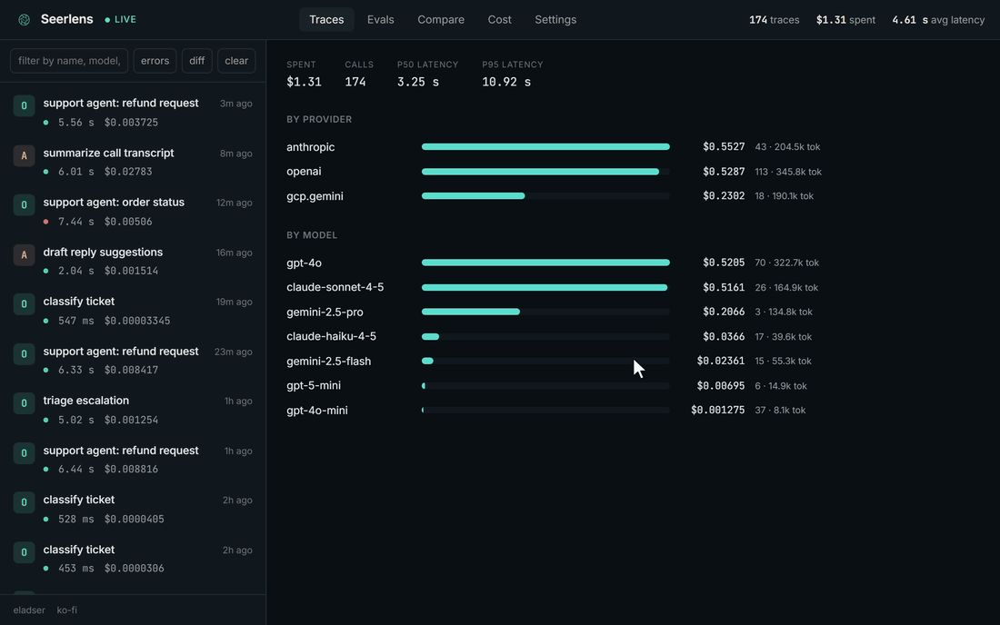

# seerlens (JavaScript)

Diff your AI calls locally, see what they really cost, fail CI when quality or cost regresses. This package sends your Node app's LLM calls to [Seerlens](https://github.com/eladser/seerlens), which runs on your machine. Start the collector first, see the [quick start](https://github.com/eladser/seerlens#quick-start).



```bash
npm install seerlens
```

```js
import * as seerlens from 'seerlens'

seerlens.configure('http://localhost:5005')

const span = seerlens.trace('answer ticket', { model: 'gpt-4o' })
const reply = await myLlm(prompt)
span.complete({ prompt, completion: reply, inputTokens: 40, outputTokens: 12 })

await seerlens.flush() // before a short script exits
```

Or record a call you already made:

```js
seerlens.record({ model: 'gpt-4o', prompt: 'hi', completion: 'hello', inputTokens: 10, outputTokens: 5, durationMs: 820 })
```

Sends are fire-and-forget and errors are swallowed, so this never blocks or throws into your app. No dependencies, needs Node 18+.

```bash
node example.js   # against a running collector
npm test
```

## Plain OpenTelemetry works too

You don't need this package if you use the Vercel AI SDK. Its OpenTelemetry integration with the stock OTLP/HTTP exporter sends the prompt, completion, tokens and cached token count:

```bash
npm install ai @ai-sdk/openai @ai-sdk/otel @opentelemetry/sdk-node @opentelemetry/exporter-trace-otlp-http
export OTEL_EXPORTER_OTLP_TRACES_ENDPOINT=http://localhost:5005/v1/traces
```

```js
// app.mjs
import { NodeSDK } from '@opentelemetry/sdk-node'
import { OTLPTraceExporter } from '@opentelemetry/exporter-trace-otlp-http'
import { OpenTelemetry } from '@ai-sdk/otel'
import { openai } from '@ai-sdk/openai'
import { generateText, registerTelemetry } from 'ai'

const sdk = new NodeSDK({ traceExporter: new OTLPTraceExporter() })
sdk.start()
registerTelemetry(new OpenTelemetry())

const { text } = await generateText({
  model: openai('gpt-4o-mini'),
  prompt: "What's the refund window?",
})
console.log(text)

await sdk.shutdown() // flushes spans before the script exits
```

With the plain `openai` package and `@opentelemetry/instrumentation-openai` you get the model and tokens but no text, because that instrumentation sends message content as log events, and Seerlens only reads traces.
