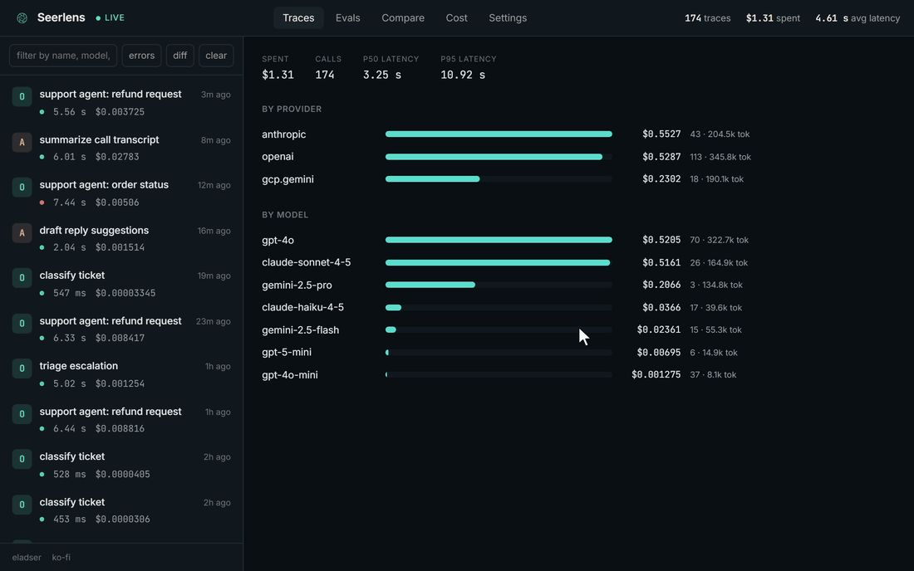

# seerlens (Python)

Diff your AI calls locally, see what they really cost, fail CI when quality or cost regresses. This package sends your Python app's LLM calls to [Seerlens](https://github.com/eladser/seerlens), which runs on your machine. Start the collector first, see the [quick start](https://github.com/eladser/seerlens#quick-start).



```bash
pip install seerlens
```

```python
import seerlens

seerlens.configure("http://localhost:5005")

with seerlens.trace("answer ticket", model="gpt-4o") as span:
    reply = my_llm(prompt)
    span.complete(prompt=prompt, completion=reply, input_tokens=40, output_tokens=12)

seerlens.flush()  # before a short script exits
```

Or record a call you already made:

```python
seerlens.record(model="gpt-4o", prompt="hi", completion="hello",
                input_tokens=10, output_tokens=5, duration_ms=820)
```

Traces are sent on a background thread. If the collector is down the trace is dropped; it never blocks or throws into your app.

No third-party dependencies. Run the example against a running collector:

```bash
python example.py
```

## Plain OpenTelemetry works too

You don't need this package if you'd rather use the OpenTelemetry OpenAI instrumentation. Point it at the collector and turn on message content:

```bash
pip install openai httpx opentelemetry-sdk opentelemetry-exporter-otlp-proto-http \
    opentelemetry-instrumentation-openai-v2==2.4b0 opentelemetry-util-genai==1.1b0
export OTEL_EXPORTER_OTLP_TRACES_ENDPOINT=http://localhost:5005/v1/traces
export OTEL_SEMCONV_STABILITY_OPT_IN=gen_ai_latest_experimental
export OTEL_INSTRUMENTATION_GENAI_CAPTURE_MESSAGE_CONTENT=span_only
```

```python
from openai import OpenAI
from opentelemetry import trace
from opentelemetry.exporter.otlp.proto.http.trace_exporter import OTLPSpanExporter
from opentelemetry.instrumentation.openai_v2 import OpenAIInstrumentor
from opentelemetry.sdk.trace import TracerProvider
from opentelemetry.sdk.trace.export import BatchSpanProcessor

provider = TracerProvider()
provider.add_span_processor(BatchSpanProcessor(OTLPSpanExporter()))
trace.set_tracer_provider(provider)
OpenAIInstrumentor().instrument()

client = OpenAI()
client.chat.completions.create(
    model="gpt-4o-mini",
    messages=[{"role": "user", "content": "What's the refund window?"}],
)
provider.shutdown()  # flushes spans before the script exits
```

Without the last two variables the spans carry the model and token counts but no prompt or completion text. The pins are there because `opentelemetry-instrumentation-openai-v2` 2.4b0 fails to import with `opentelemetry-util-genai` 1.2 or later, and it needs `httpx`, which `openai` 3.x no longer pulls in.
